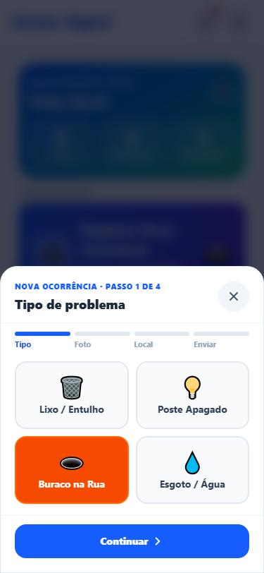
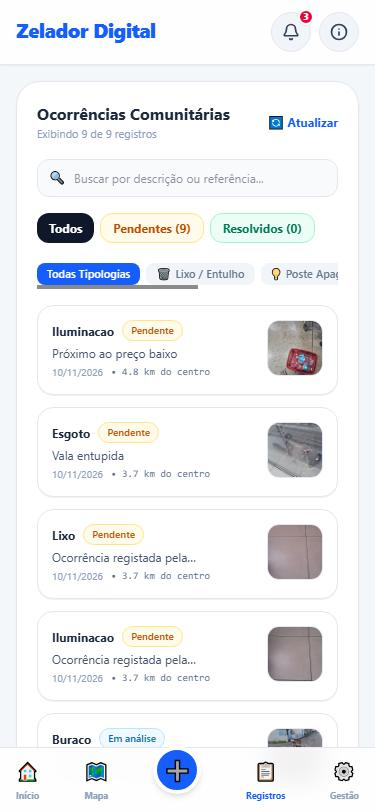
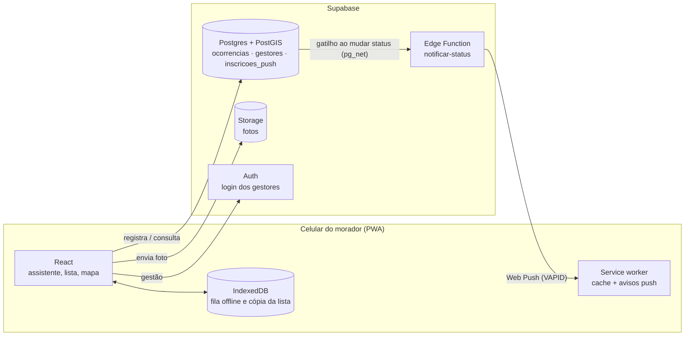

<div align="center">


# Rua Viva

**Plataforma cívica para mapear, registrar e acompanhar problemas urbanos em Ananindeua (PA).**

O morador fotografa um buraco, um poste apagado, lixo acumulado ou um vazamento de esgoto; o app marca o ponto no mapa, gera um número de protocolo e avisa no celular quando o status muda.

[**Abrir o app →**](https://zeladordigital.vercel.app)

[](https://github.com/Danteifpa/zelador-digital/actions/workflows/ci.yml)
[](LICENSE)


</div>

---

## Capturas de tela

| Início | Nova ocorrência | Registros |
| :---: | :---: | :---: |
|  |  |  |

## Funcionalidades

**Para o morador**

- **Registro em 4 passos**: tipo de problema → foto (câmera do celular) → localização GPS → revisão. Acessível por leitor de tela, com áreas de toque grandes e **Modo Fácil** com voz.
- **Protocolo na hora** (`ZD-XXXXXX`), mesmo sem internet, e consulta pública do andamento.
- **Avisos no celular** (Web Push) quando o status muda: *Pendente → Em análise → Resolvido*.
- **Funciona offline**: registros ficam no celular (IndexedDB) e são enviados sozinhos quando a rede volta; lista e mapa abrem com os últimos dados salvos.
- **Instalável** na tela inicial (PWA), com aviso quando há uma versão nova.
- Foto comprimida no próprio celular (≈ 1280 px, WebP) e GPS lido da foto (EXIF).

**Para a gestão comunitária**

- Painel com login (Supabase Auth), priorização **GUT** (Gravidade × Urgência × Tendência) e mapa de focos críticos.
- Tramitação com despachos públicos e foto de resolução (antes/depois).
- Ofício em A4 pronto para imprimir, boletim para WhatsApp e exportação **CSV** e **GeoJSON**.
- **Encaminhamento por órgão** (iluminação, limpeza, saneamento, vias...): cada chamado vai sozinho para o órgão da categoria; gestor de um órgão só altera o que é dele e pode encaminhar para outro.
- **Prazos por órgão** com aviso de atraso e filtro "Atrasados".
- **Ordem de serviço** para a equipe de campo (A4 ou WhatsApp, com rota de cada ponto) e **relatório mensal** por órgão e bairro.
- Tela de **computador** em duas colunas: lista à esquerda, mapa e detalhes à direita.

**Para prefeituras**

- Nome, cidade, prefeitura, centro do mapa e categorias configuráveis por variáveis de ambiente (veja `frontend/.env.example` e `frontend/src/lib/marca.js`), sem mexer no código.

## Tecnologias

| Camada | Uso |
| --- | --- |
| [React 19](https://react.dev) + [Vite 8](https://vite.dev) | Interface e build |
| [Tailwind CSS 4](https://tailwindcss.com) | Estilos |
| [Leaflet](https://leafletjs.com) + [React Leaflet](https://react-leaflet.js.org) | Mapas (OpenStreetMap / CARTO) |
| [vite-plugin-pwa](https://vite-pwa-org.netlify.app) (Workbox) | Service worker, cache offline, atualizações |
| [Supabase](https://supabase.com) | Postgres + PostGIS, Auth, Storage, Edge Functions, RLS |
| [Vercel](https://vercel.com) | Hospedagem e deploy a cada merge na `main` |

## Arquitetura



Detalhes (fila offline, segurança, estados, avisos): [`docs/ARQUITETURA.md`](docs/ARQUITETURA.md).

## Como rodar localmente

Pré-requisito: **Node.js 22** (ver [`.nvmrc`](.nvmrc)).

```bash
git clone https://github.com/Danteifpa/zelador-digital.git
cd zelador-digital/frontend
npm ci
npm run dev        # http://localhost:5173
```

| Comando | O que faz |
| --- | --- |
| `npm run dev` | Servidor de desenvolvimento |
| `npm run build` | Build de produção em `dist/` (com service worker) |
| `npm run preview` | Serve o build localmente |
| `npm run lint` | ESLint |
| `npm test` | Testes automáticos (Vitest): status, protocolo, prioridade GUT, "Também vi", fila offline, envio em segundo plano e ErrorBoundary |

### Variáveis de ambiente (`frontend/.env.local`, opcionais)

| Variável | Padrão | Uso |
| --- | --- | --- |
| `VITE_SUPABASE_URL` | projeto de produção | URL do Supabase |
| `VITE_SUPABASE_ANON_KEY` | chave pública de produção | Chave pública (*publishable*) do Supabase |
| `VITE_VAPID_PUBLIC_KEY` | chave de produção | Chave pública dos avisos push |

As chaves acima são **públicas** por definição: a proteção dos dados é feita pelas regras de acesso (RLS) no banco. Segredos (chave privada VAPID, chave de serviço) ficam só no Supabase.

## Banco de dados e servidor

Tudo o que roda no Supabase está versionado em [`supabase/`](supabase/):

- [`migrations/`](supabase/migrations/) — regras de acesso, estados, avisos push (aplicar em ordem de data);
- [`functions/notificar-status`](supabase/functions/notificar-status/) — envio dos avisos;
- [`supabase/README.md`](supabase/README.md) — passo a passo (gestores, segredos, verificação).

## Estrutura do projeto

```
zelador-digital/
├── frontend/                 # App (React + Vite)
│   ├── public/               # Ícones, manifest, push-sw.js
│   └── src/
│       ├── App.jsx           # Estado principal e telas do morador
│       ├── components/       # Telas e componentes (assistente, cabeçalho, avisos...)
│       │   └── gestao/       # Painel de gestão (lista, mapa GUT, ofício, boletim...)
│       └── lib/              # Regras e serviços (status, fila offline, push, protocolo...)
├── supabase/                 # Migrações SQL e Edge Functions
├── docs/                     # Arquitetura e imagens
└── .github/                  # CI, modelos de issue e de pull request
```

## Contribuir

Sugestões, relatos de problemas e pull requests são bem-vindos. Leia o [guia de contribuição](CONTRIBUTING.md) e use os [modelos de issue](https://github.com/Danteifpa/zelador-digital/issues/new/choose).

Encontrou uma falha de segurança? **Não abra issue pública** — veja [`SECURITY.md`](SECURITY.md).

Histórico de versões: [`CHANGELOG.md`](CHANGELOG.md).

## Licença

[GNU AGPL-3.0](LICENSE) © 2026 Dante Dias Monteiro. Veja também [`NOTICE`](NOTICE).

Você pode usar, estudar, modificar e redistribuir o código. Quem oferecer o Rua Viva (ou uma versão modificada) a outras pessoas pela internet, por exemplo como serviço para um órgão público, precisa publicar o código-fonte completo dessa versão sob a mesma licença.

As versões publicadas até a v1.1.0 e até o commit anterior a esta mudança (14/11/2026) continuam sob a licença MIT.

O nome **Rua Viva** (antes Zelador Digital e Bora Zelar) e a identidade visual do projeto não são licenciados: não use a marca para oferecer cópias ou serviços derivados sem autorização.

Projeto independente de iniciativa comunitária, sem vínculo com a Prefeitura de Ananindeua.

<p align="right">
  <picture>
    <source media="(prefers-color-scheme: dark)" srcset="docs/img/logo-dante-branco.png" />
    
  </picture>
</p>
