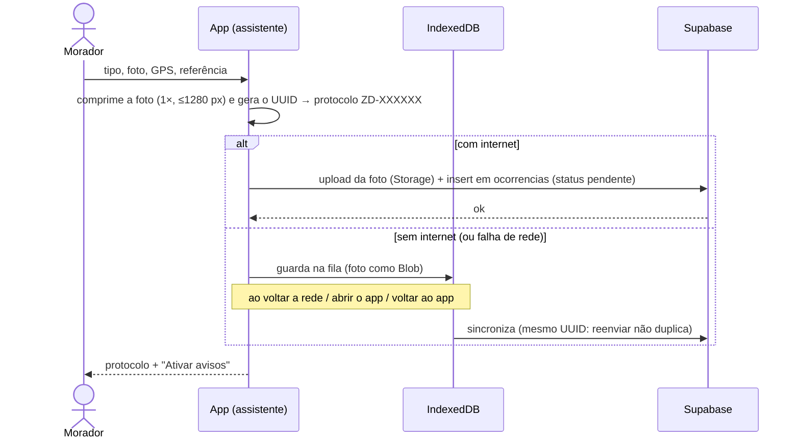
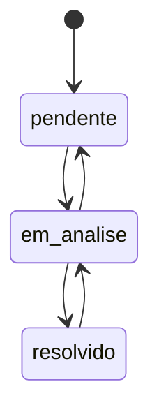
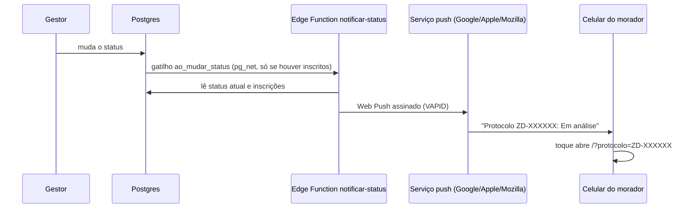

# Arquitetura do Zelador Digital

Visão técnica de como o app funciona. Para rodar o projeto, veja o [README](../README.md).

## Visão geral

O Zelador Digital é uma **PWA** (React + Vite) hospedada na Vercel que fala diretamente com o **Supabase**. Não há servidor próprio: as regras de negócio que precisam de confiança ficam no banco (RLS, restrições, gatilhos) e numa Edge Function.

| Parte | Onde | Responsabilidade |
| --- | --- | --- |
| Telas do morador | `frontend/src/App.jsx`, `components/` | Registro, lista, mapa, consulta de protocolo |
| Painel de gestão | `components/PainelGestor.jsx`, `components/gestao/` | Login, priorização GUT, tramitação, ofício |
| Regras compartilhadas | `frontend/src/lib/` | Estados, protocolo, fila offline, push, imagens |
| Banco e permissões | `supabase/migrations/` | Tabelas, RLS, restrições, gatilhos |
| Avisos | `supabase/functions/notificar-status` | Envio de Web Push |

## Registro de uma ocorrência

- **Protocolo**: `ZD-` + 6 primeiros caracteres do UUID, gerado no celular (`lib/protocolo.js`). Existe antes do envio, por isso funciona offline.
- **Fila offline** (`lib/filaOffline.js`): IndexedDB, foto como Blob. A sincronização relê a fila antes de remover itens (nada guardado durante o envio se perde), não envia sem foto se o upload falhar e trata chave duplicada (`23505`) como "já enviado".

## Estados

Só existem três, garantidos por uma `CHECK` no banco e lidos por `lib/status.js`:

## Segurança

| Quem | Ler ocorrências | Registrar | Alterar / excluir | Inscrições push |
| --- | --- | --- | --- | --- |
| Morador (sem login) | sim | sim, sempre `pendente` | não | só inserir a própria |
| Conta logada sem ser gestora | sim | sim | não | só inserir |
| Gestor (`public.gestores`) | sim | sim | sim | — |

- **RLS** em `ocorrencias`, `gestores` e `inscricoes_push`; a vista `ocorrencias_georreferenciadas` usa `security_invoker` e é só de leitura.
- O login dos gestores usa Supabase Auth; a permissão é confirmada no servidor por `public.eh_gestor()`. O registro público de contas está desligado.
- As chaves no código do app (Supabase *publishable*, VAPID pública) são públicas por definição.

## Avisos push

A função recebe **só o id** da ocorrência e confirma tudo no banco; `ultimo_status_notificado` evita avisos repetidos. Inscrições canceladas (404/410) são apagadas. No iPhone, os avisos só funcionam com o app instalado na Tela de Início.

## Desempenho e PWA

- Mapa (Leaflet), Painel de Gestão e QR Code são carregados **sob demanda** (`React.lazy`); o arranque baixa ≈ 150 kB (gzip).
- Service worker (Workbox, `registerType: 'prompt'`): precache do app, cache de tiles do mapa (30 dias) e fotos (7 dias); o aviso "Há uma versão nova" deixa o usuário escolher quando atualizar.
- `ErrorBoundary` na raiz e em cada seção pesada: um erro mostra "Tentar novamente" em vez de tela branca.
